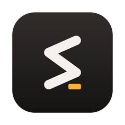
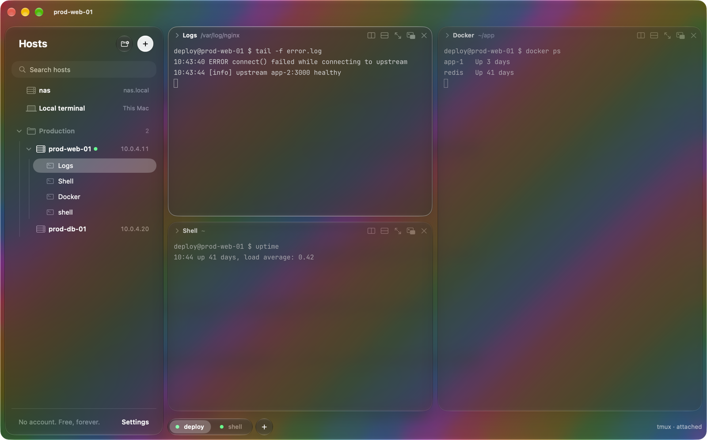

<p align="center"></p>

# Soltz

A native macOS SSH client: terminals and file transfer, nothing else. Free, no account. macOS 27 or later, Apple
silicon.



Soltz is a Swift rewrite of [Voltius](https://github.com/VoltiusApp/voltius): its Rust core is a trimmed, modified
copy of that project's backend, and the app is a port of its frontend. Licensed under the GNU Affero General Public
License v3.0 (`LICENSE`); credits and third-party notices are in `NOTICE.md`.

## Install

1. Download `Soltz-<version>.zip` from [Releases](https://github.com/ultramenid/soltz/releases/latest), unzip it and
   move Soltz to Applications.
2. Open it. macOS refuses the first time, because the build is not notarized by Apple (see "What you trust"): open
   System Settings → Privacy & Security, find the line about Soltz and click Open Anyway. This is asked once.

To update, download the newer release and replace the app; your hosts and saved logins stay. The Keychain then asks
once to let the new build use Soltz's vault key (choose Always Allow), for the same reason.

## Build

Needs Rust (through rustup, which reads `core/rust-toolchain.toml`) and Apple's Command Line Tools. Full Xcode is
optional; with it the app gets its layered icon.

```sh
sh scripts/bundle-app.sh        # builds the core if needed, then build/Soltz.app
open build/Soltz.app
```

The build is signed ad hoc, so macOS asks before the first launch, and the Keychain asks for access to the vault key
once after every rebuild.

## Tests

```sh
sh scripts/test-all.sh                              # every Swift package
(cd core/crates/soltz-core && cargo test)           # Rust core
SOLTZ_HARNESS=1 sh scripts/bundle-app.sh            # build/test.noindex/SoltzTest.app, the app with its test harness
build/test.noindex/SoltzTest.app/Contents/MacOS/Soltz --smoke    # the app on temp data and an in-memory keychain
sh scripts/e2e.sh                                   # the app against a throwaway sshd on 127.0.0.1
```

The tests never read or write your real data, your login keychain or `~/.ssh`, and connect to no host but
127.0.0.1. The unit tests inside upstream's Rust modules (`#[cfg(test)]` blocks under `core/`) are not run here:
they need fixtures that are not in this repository.

## Security

How Soltz treats what you give it:

- **Host keys.** The first time you connect to a host, Soltz shows its key fingerprint and waits; nothing is sent
  until you trust it. A key that later changes is shown beside the trusted one, and accepting it replaces the old
  one. Cancel is the default answer to both.
- **Saved passwords and keys** are encrypted in `secrets.enc` (XChaCha20-Poly1305); its key is in the macOS
  Keychain. A host's environment-variable values, notes and pre/post commands are in the vault too. What is left in
  plain files in `~/Library/Application Support/Soltz` (readable only by you) is what names a host: its name,
  address, port, user, group and options.
- **A host that logs in with a key never gets your password**, and a jump host gets only its own login.
- **Servers are not trusted.** A server cannot open channels towards your Mac that Soltz did not ask for. File
  names a server lists are checked before they become paths on your Mac,
  downloaded files are marked as downloaded (macOS checks apps and scripts among them before their first run), and
  a program in the terminal must ask before it can change your clipboard. Risky pastes are asked about.
- **Updates.** The app only checks whether a newer release exists and links to its page on GitHub. It downloads and
  installs nothing.

### What you trust

- The **terminal engine** is [Ghostty](https://github.com/ghostty-org/ghostty), taken as a prebuilt library from
  [libghostty-spm](https://github.com/Lakr233/libghostty-spm), a third-party package that builds Ghostty with its
  own patches. That library runs inside the app, so it sees your keystrokes and the terminal's output. It is pinned
  twice: to one commit of the package (`Packages/SoltzTerminal/Package.swift`), and to the SHA-256 of the library
  itself (`scripts/bundle-app.sh`, which refuses to build with any other). The pins make sure you get the same
  binary every time; they do not make it reviewed: it is not built from source or audited here. To change that,
  build it with the package's own `build.sh` from Ghostty's source and update the hash.
- The **SSH implementation** is [russh](https://github.com/Eugeny/russh), with the versions in
  `core/crates/soltz-core/Cargo.lock` (builds use exactly those: `--locked`).
- Builds are **not signed with an Apple Developer ID** and not notarized.

### Reporting a problem

Please report security problems privately, as a
[security advisory](https://github.com/ultramenid/soltz/security/advisories/new), rather than in a public issue.
Anything else is welcome as an [issue](https://github.com/ultramenid/soltz/issues).
